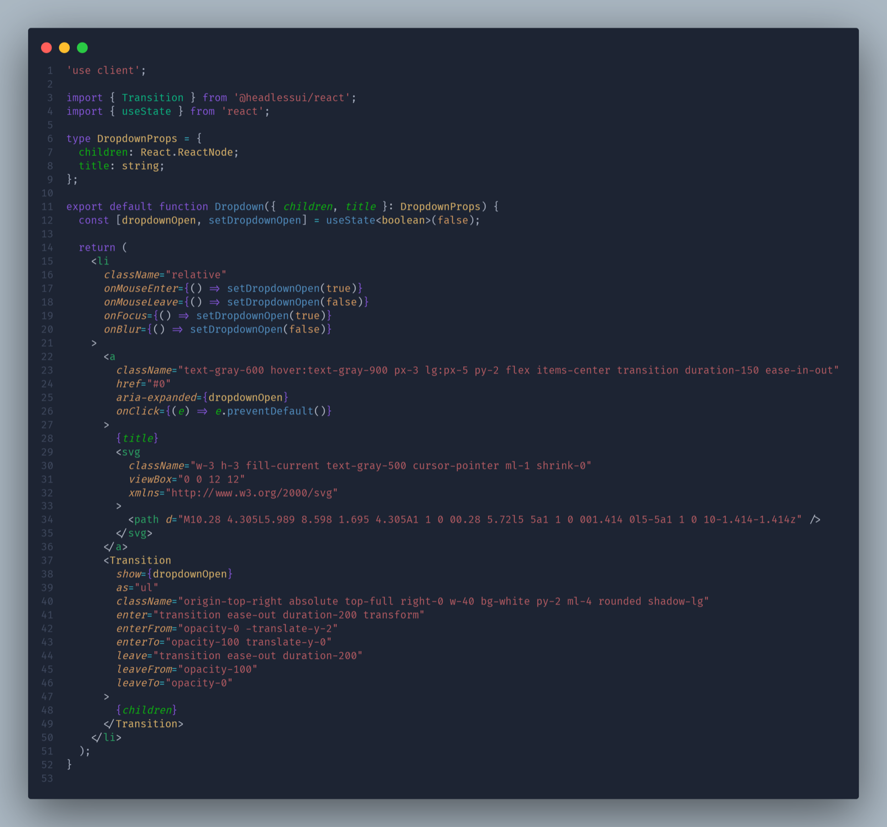
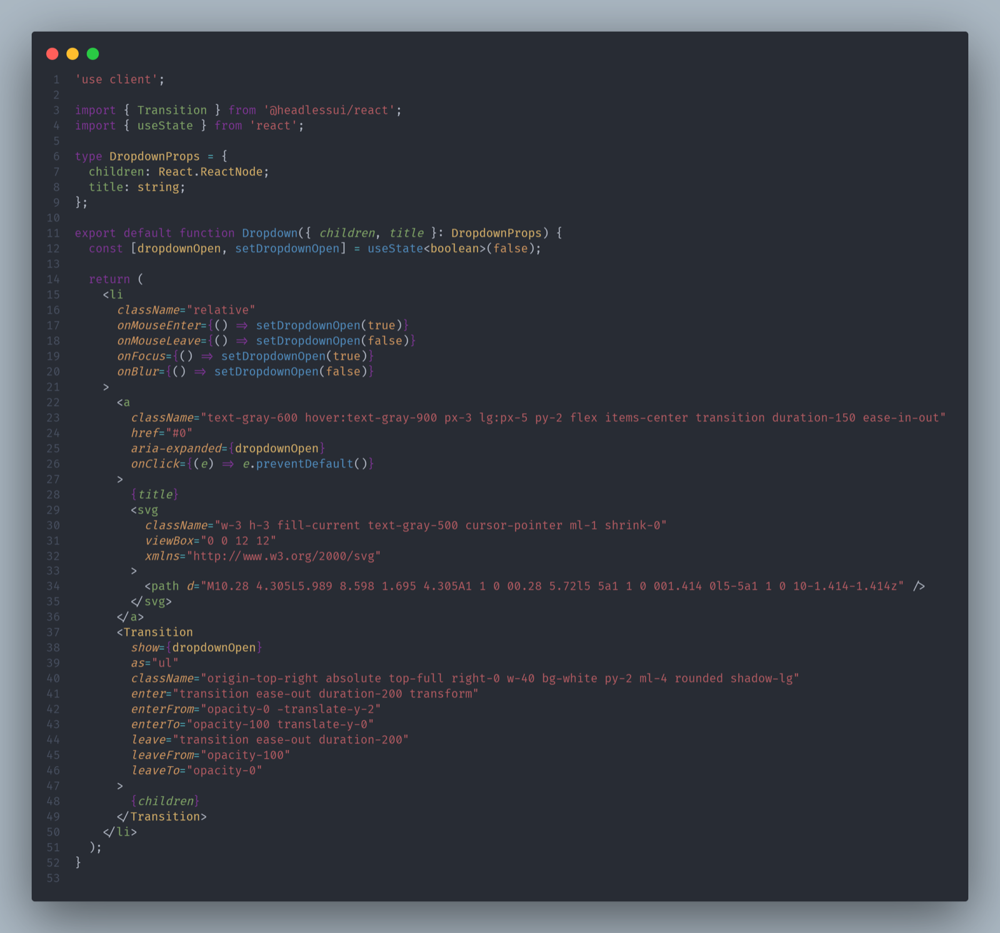

# Azalais Dark

<p align="center"></p>

A dark theme for VS Code made to reduce eye fatigue, with a palette chosen to stay readable for people with tritanopia, deuteranopia and protanopia.

It comes in two variants:

- **Azalais**: the classic, calmer palette.
- **Azalais Glow**: brighter accents for more contrast.

## Install

Install **Azalais Dark** from the [VS Code Marketplace](https://marketplace.visualstudio.com/items?itemName=ChristopherAlphonse.azalais-dark-theme), or press `Ctrl/Cmd + P` and run:

```
ext install christopheralphonse.azalais-dark-theme
```

Then open **Preferences: Color Theme** (`Ctrl/Cmd + K`, `Ctrl/Cmd + T`) and pick **Azalais** or **Azalais Glow**.

## Azalais Glow



## Azalais



## Release

Releases come from one GitHub Actions workflow ([.github/workflows/publish.yml](.github/workflows/publish.yml)), so you never bump, tag or write the changelog by hand.

```sh
npm run release          # patch bump, then watches the run
npm run release:minor
npm run release:major
```

Or open **Actions → Release → Run workflow** on GitHub and pick the bump.

Versions live in `v*` tags, not on `main`. `main` only accepts pull requests, so the workflow never pushes to a branch. It takes the highest `v*` tag, bumps it, builds a release commit on top of `main` with the new `version` and a `CHANGELOG.md` entry from the commit messages since that tag, tags it `vX.Y.Z`, publishes to the Marketplace with Trusted Publishing (GitHub OIDC, no stored token), and creates a GitHub release with the VSIX attached. The `version` in `package.json` on `main` is not updated and doesn't matter.

Don't push `v*` tags yourself. The Marketplace Trusted Publishing policy is tied to the workflow file name `publish.yml`.
